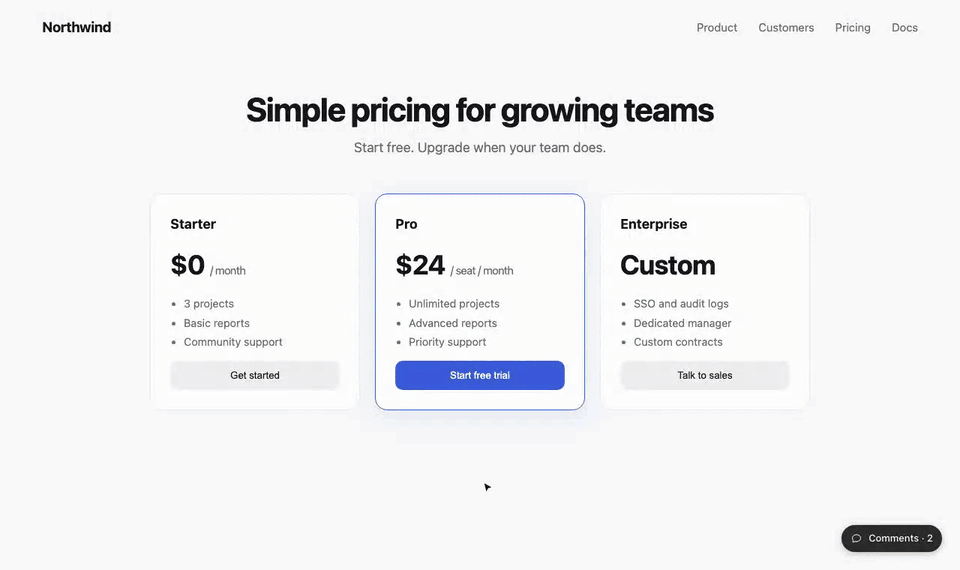

# Dogear

Figma-style comments on any web page. Click to drop a pin or drag to mark an area, then write.
You get threads, replies, edit, resolve, and live updates. It works in plain HTML, React and Next.js.

Use it for design reviews on a staging site, feedback from visitors on a live one, or to hand
what people said straight to your coding agent.

<p align="center">
  
</p>

**Bring your own backend, or use ours.** `@harshi04/dogear/server` is the whole backend as one route handler
over Postgres, a JSON file or memory: it works with nothing but a database, and turns on guests,
your sign-in, private pages and moderation as you add them. Or give Dogear a five-function adapter
over Supabase, Firebase, your own API, or anything else. It also works with no backend at all,
using localStorage.

**Contents**

- Start: [Install](#install) · [Quick start](#quick-start) · [Set it up with your coding agent](#set-it-up-with-your-coding-agent) · [How it works](#how-it-works)
- Set up: [Pick your backend](#pick-your-backend) · [Props](#props) · [Layouts](#layouts) · [Comments that remember a form](#comments-that-remember-a-form)
- Agents: [MCP](#use-it-with-your-coding-agent-mcp) · [Copy as Markdown](#hand-feedback-to-an-agent-by-hand)
- Look: [Theming](#theming) · [How pins stay put](#how-pins-stay-put)
- Repo: [Examples](#examples) · [Working on Dogear](#working-on-dogear) · [License](#license)

## Install

```bash
npm install @harshi04/dogear     # or pnpm / yarn / bun
```

For plain HTML, load it from a CDN, or download `element.global.js` from a
[release](https://github.com/harshii0509/dogear/releases) and serve it from your own site:

```html
<script src="https://cdn.jsdelivr.net/npm/@harshi04/dogear@0.6/dist/element.global.js"></script>
```

## Quick start

**Plain HTML**

```html
<script src="/dogear/element.global.js"></script>
<dogear-comments shortcut="c"></dogear-comments>
```

**React**

```tsx
import { Comments } from "@harshi04/dogear/react";

<Comments shortcut="c" />;
```

**Next.js (App Router)**

```tsx
// app/dogear-comments.tsx
"use client";
import { Comments } from "@harshi04/dogear/react";
export const DogearComments = () => <Comments shortcut="c" />;
// then render <DogearComments /> once in app/layout.tsx
```

With no adapter, comments are stored in this browser's localStorage, which is enough to try it out.
Press C, click anything on the page, and write. To share comments between people, [pick a backend](#pick-your-backend).

## Set it up with your coding agent

Open Claude Code, Cursor, Codex or any coding agent in your project and paste this. It's an
ordinary request in your own words: the agent looks at your project, asks you a few questions,
sets Dogear up, and ends with a list of what's left for you to do. It asks before it installs
anything, it leaves your secrets to you, and nothing is sent anywhere.

```text
I'd like to add Dogear (npm: @harshi04/dogear, MIT licence) to this project. It's Figma-style
comments on our pages: pins, threads, replies and resolve. Please set it up with me.

1. First look around: our framework, any sign-in we already have, our database, and where we
   host. Then ask me these in one message, with your recommendation for each:
   - Where should comments be stored? (For a Node or Next.js app, Dogear's own route handler
     over our Postgres. A JSON file or memory just to try it. Or an adapter for Supabase or our
     own API.)
   - Who can comment? (Our existing sign-in, or visitors who just give a name.)
   - Who should see comments? (Everyone, or only some pages or environments.)
   - Should my coding agent be able to read and reply to comments? (Dogear has an MCP server.)
   Please wait for my answers before installing anything.

2. Install @harshi04/dogear and set it up the way I choose. Use the package's docs as the
   reference: node_modules/@harshi04/dogear/README.md, docs/server.md (createDogear, stores
   and options), docs/contract.md (the rules every backend keeps) and docs/examples/.
   - The author of a comment should come from the server (our session, or Dogear's signed
     guest cookie), never from the browser.
   - Mount the comments once, near the root of the app.

3. For secrets, please add the variable names to .env.example (or list them for me) and leave
   the values to me. Don't commit, push or deploy; I'll do that myself.

4. Check that it works: typecheck and build, and if there's a route, start the dev server and
   try GET /me and a POST with curl.

5. Finish with two short lists:
   - Done: each file you added or changed, one line each.
   - My turn: what I still need to do, in order. Include each environment variable to set
     (locally and on our host) and how to make its value, any database step, and how to try
     it (open the app, press C, drop a pin, reply). Then the optional extras: theming with the
     --dogear-* CSS variables, moderation, and connecting a coding agent (MCP).
```

## How it works

**One widget, one route.** The widget on your page talks to a single route that `createDogear`
makes. The route checks who you are and what you may see, then stores the comment. Everything
past plain commenting is optional, and switches on when you give it what it needs.


**Nobody has to sign in.** With `guests: true`, a visitor gives a name the first time and
comments. The server signs a cookie, so the author never comes from the browser.
[docs/server.md](docs/server.md)


**Tag someone, and they hear about it.** With your own sign-in, `@` lists the people who can open
the page. They see it in the app (a toast and an `@` badge), and `notify` can tell them wherever
your team talks. [Mentions](docs/server.md#mentions) · [Alerts](docs/server.md#alerts)


**An assistant that answers in the thread.** Give `assistant` your own `answer(thread)`: your
model, your docs. Dogear decides when to ask and saves the reply, marked as AI.
[An assistant](docs/server.md#an-assistant)


**From a comment to a fix, and back.** Your coding agent reads the threads over MCP, with each
element's selector and text, makes the change, then replies and resolves.
[docs/mcp.md](docs/mcp.md)


The diagrams are drawn by [`media/diagrams.mjs`](media/diagrams.mjs).

## Pick your backend

To have your agent choose and set it up with you, paste the prompt in
[Set it up with your coding agent](#set-it-up-with-your-coding-agent). To do it yourself:

| You have | Use |
|---|---|
| Nothing yet, just trying | `localAdapter()` (the default) |
| A Node server (Next.js, Hono, …) | `createDogear` from `@harshi04/dogear/server`, then `httpAdapter("/api/comments")`: [docs/server.md](docs/server.md) ([Next + Postgres](docs/examples/next-postgres.md)) |
| A server route you write yourself | `httpAdapter("/api/comments")` with the [REST shape](docs/contract.md#the-rest-shape-for-httpadapter) |
| Supabase | [a ready adapter with RLS and realtime](docs/examples/supabase.md) |
| Anything else | implement [`Adapter`](docs/contract.md) (five functions) |

```ts
type Adapter = {
  me(): Promise<User | null>;
  list(path: string): Promise<Comment[]>;
  create(input: NewComment): Promise<Comment>;
  update(id: string, patch: { body: string } | { resolved: boolean }): Promise<Comment>;
  remove(id: string): Promise<string[]>;
  subscribe?(path: string, onChange: () => void): () => void;
};
```

**The whole thing in Next.js**, over Postgres, with visitors who comment under a name. The route
goes in `app/api/comments/[[...rest]]/route.ts`:

```ts
import { createDogear, postgresStore } from "@harshi04/dogear/server";
import postgres from "postgres"; // or Neon, or pg: see docs/examples/next-postgres.md

const sql = postgres(process.env.DATABASE_URL!);

const dogear = createDogear({
  store: postgresStore({ query: (text, params) => sql.unsafe(text, params as never[]) }), // makes its table on first use
  guests: true,
  secret: process.env.DOGEAR_SECRET, // signs the guest cookie: 32+ random characters
});

export { dogear as GET, dogear as POST, dogear as PATCH, dogear as DELETE };
```

and the widget, rendered once in `app/layout.tsx`:

```tsx
// app/dogear-comments.tsx
"use client";
import { Comments, httpAdapter } from "@harshi04/dogear/react";

const adapter = httpAdapter("/api/comments", { guests: true }); // made once, outside the component
export const DogearComments = () => <Comments adapter={adapter} shortcut="c" />;
```

To use your own sign-in instead of guests, swap `guests` and `secret` for
`auth: async (request) => /* your session → { id, name, avatar?, admin? } or null */`, and drop
`{ guests: true }` from the adapter. Every option is in [docs/server.md](docs/server.md#options).

**What to import from where.**

| Import | What it holds |
|---|---|
| `@harshi04/dogear` | `localAdapter`, `httpAdapter`, `validateNew`, `toMarkdown`, and the types (`Comment`, `User`, `Adapter`, …). No DOM, so it's safe on a server |
| `@harshi04/dogear/react` | `<Comments>`, `useDogearSnapshot` and `peekSnapshot`, plus everything in the main entry |
| `@harshi04/dogear/element` | defines `<dogear-comments>`; `mount`, `threads` and `markdown`. The CDN's `element.global.js` is the same, as the global `Dogear` |
| `@harshi04/dogear/server` | `createDogear`, the stores (`memoryStore`, `fileStore`, `postgresStore`, `schema`) and `webhook`. Node only; the browser never imports it |
| `npx dogear` | the CLI: `dogear serve` (a local comments server) and `dogear mcp` (for coding agents) |

**Rules that always hold.**

- The author of a comment comes from the server (your session, or Dogear's signed guest cookie), never from the browser.
- Only authors edit. Authors or admins delete: return `admin: true` from `me()` for your admins.
- Mount the comments once, near the root of the app. The adapter is read once, on mount.
- Threads are keyed by path without the query, so `/pricing?review` and `/pricing` share them.

Every rule a backend must keep is in [docs/contract.md](docs/contract.md). Use `validateNew` from
`@harshi04/dogear` in your own server code to check a new comment.

**How guests work.** `httpAdapter("/api/comments", { guests: true })` gives the adapter a
`join(name)`, which calls `POST /me { name }`; the route (with `guests: true`) signs the visitor
in with a cookie and returns them. A custom adapter does the same by having a `join(name)`. Signed-out visitors then see the threads, and are
asked for a name the first time they write. `localAdapter({ user: null })` tries the flow
locally, and so does `npx dogear serve --guest`. With `avatars`, the name step also offers them to
pick from (one picked at random to start); the key goes to `POST /me { name, tint }`, and your
route keeps it as `User.tint` if it's one of yours. On a public page, pair it with
`resolvers="authors"`, rate limits in your route, and an admin who can delete.

Want live cursors and presence? See [ROADMAP.md](ROADMAP.md): it needs a realtime service.

## Props

Each prop of `<Comments>` has an attribute on `<dogear-comments>`, except the ones that take a
function or a React node (marked —). On the element, `endpoint="/api/comments"` makes an
`httpAdapter` for you, and `guests` adds `{ guests: true }`. From a script, `Dogear.mount({ adapter, layout, navigate, … })`
takes every prop but `enabled` and `icons`, functions included.

| Prop | Attribute | Default | What it does |
|---|---|---|---|
| `adapter` | `endpoint`, or the element's `adapter` property | `localAdapter()` | where comments live; read once on mount |
| `shortcut` | `shortcut` | none | a key that toggles comment mode, e.g. `"c"` |
| `ignore` | `ignore` | none | a CSS selector to keep comments off, e.g. `"nav, .chat-widget"`. Pressing on a match does nothing |
| `activation` | `activation` | `"always"` | `"param"` shows the layer only after `?review` is in the URL, then for the rest of the tab; `?review=off` ends it. Plain visitors see a clean page |
| `reviewParam` | `review-param` | `"review"` | the query parameter `activation="param"` listens for |
| `enabled` | — | `true` | `false` renders nothing (e.g. only on preview deploys) |
| `layout` | `layout` | `"fab"` | `"tray"`: a pill that opens into a list of every thread; `"dock"`: a button you drag anywhere that opens into controls and a list (see [Layouts](#layouts)) |
| `navigate` | — | full page load | how a tray row on another page gets there, e.g. your router's `push` |
| `pageLabel` | — | the path | what a page is called in the tray's list, e.g. `(path) => titles[path] ?? path` |
| `deletable` | — | its author, or an admin | who may delete a comment, to match the server's `deletable`, e.g. anyone may delete the assistant's |
| `linkParam` | `link-param` | `"dogear"` | the query parameter of a link to a thread, e.g. `"comment"` for `?comment=<id>`; a reply's id opens its thread. `?dogear=` always works too |
| `onActiveChange` | — | none | called with `true`/`false` when the visitor opens or closes comments (or a thread link opens them), e.g. for analytics; not on a reload |
| `resolvers` | `resolvers` | `"anyone"` | `"authors"` shows Resolve only to the thread's author and admins, for public pages |
| `resolve` | `no-resolve` | `true` | `false`: no resolving at all, just a list of comments. Every thread shows, with no Resolve, Reopen or Resolved switch |
| `icons` | — | Dogear's own | your icon set, by name (see [Theming](#theming)) |
| `joinFirst` | `join-first` | `false` | with guests and the tray: opening the comments first asks a visitor's name and avatar, then shows the threads and pins |
| `reactions` | `reactions='[…]'` | none | the emoji people can react with, e.g. `["❤️", "👍", "😂", "🔥", "👀", "🎉"]`: chips with counts under comments, yours ringed, and a + that unfolds the set. Needs an adapter with `react` |
| `reactionsIn` | `reactions-in` | `"everywhere"` | `"thread"`: reactions only on an open comment, not in the tray's list |
| `emojiData` | `emoji-data` | jsDelivr's `emojibase-data@17` | where the set's "···" picker loads every other emoji from, read as `${emojiData}/en/data.json`. Point it at your own copy of Emojibase's data to self-host |
| `theme` | `theme` | `"dark"` | `"light"`, or `"auto"` to follow the visitor's system setting. Changing the attribute redraws at once. See [Theming](#theming) |
| `pick` | `pick` | `"element"` | `"pin"`: the pin you'd drop, with your avatar, follows the pointer and a click drops it. Nothing on the page is outlined or named, and there are no areas, for sites whose visitors comment rather than inspect |
| `locations` | `no-locations` | `true` | `false`: no page or "on heading …" under comments in the list or on an open one, just name · time and the text. Pins still show where |
| `avatars` | `avatars='{…}'`, or the element's `avatars` property | none | avatars for people without a photo, by key: `{ sky: "linear-gradient(…)" }`. Guests pick one with their name; everyone else gets one by id |

**Your page's own shortcuts.** While comment mode is on, the layer's host on the page carries
`data-active`, so a page shortcut can stand down rather than fire as someone writes a comment.
Key events from Dogear's fields reach the page retargeted to that host, so check
`event.composedPath()[0]` rather than `event.target` for a field:

```js
addEventListener("keydown", (event) => {
  if (document.querySelector("[data-comment-layer][data-active]")) return;
  const target = event.composedPath()[0];
  if (target.isContentEditable || target.closest?.("input, textarea, select")) return;
  // …your shortcut
});
```

## Layouts

**`"fab"`** (the default) is one button that turns comment mode on and off, as in Figma: in
comment mode every press places a comment.

**`"tray"`** suits a site with visitors, such as a portfolio or docs:
- A pill sits bottom-right: "Leave a comment" and its key.
- Clicking it opens the tray out of the pill, which stays put as the tray's footer: one list, this
  page's threads first, then other pages' (each showing its path), newest first. Pins show while
  it is open, and the page stays usable.
- A row on this page scrolls to its element and opens it. A row on another page goes there (with
  `navigate`) and opens it on arrival.
- The shortcut, or the pill again, places one comment, then returns to the tray. Esc steps back:
  the draft, the open thread, placing, then the tray.
- Closing the tray hides every pin.

**`"dock"`** suits a product team reviewing an app all day:
- A round button, with the number of open threads on every page. Drag it to any corner; this
  browser remembers where.
- Clicking it opens a row of controls: add a comment (click to pin, drag for an area), the eye
  (show or hide pins, the page stays usable either way), the list with the open count, and ✕.
- The list opens the row into a panel of every thread, this page first, with an `@` filter for
  mentions of you and a resolved switch. Drag it by its head.
- It opens away from the nearest edges. Esc steps back one thing at a time: the panel, the draft,
  the open thread, placing, then the row. The pins stay until the eye hides them.
- Its first place is `--dogear-right` / `--dogear-bottom` from the corner (24px).

```tsx
const router = useRouter();
<Comments layout="tray" shortcut="c" navigate={router.push} />;
// Just a list of comments, no resolving:
<Comments layout="tray" resolve={false} navigate={router.push} />;
```

To review a page without everyone else seeing the layer, set `activation="param"` and send
reviewers a link with `?review`. The parameter isn't part of where comments live:
`/pricing?review` and `/pricing` share threads.

## Comments that remember a form

A comment left halfway through a form keeps the form, so whoever opens it sees what you saw.
Register the form's state; Dogear saves it with each thread started while the form is on screen,
puts it back when the thread is opened, and shows "Showing Alex's form · Back to my form".

```tsx
import { peekSnapshot, useDogearSnapshot } from "@harshi04/dogear/react";

const [state, setState] = useState(() => ({ ...EMPTY, ...peekSnapshot<Setup>("setup:stripe") }));
useDogearSnapshot("setup:stripe", state, (saved) => setState(saved));
```

The key names the form and what it fills in, so a snapshot only lands where it came from.
`peekSnapshot` covers a thread opened from another page: the form mounts already filled in. Any
JSON up to 64 KB; it comes back with its page's comments and is left out of every-page lists.
Without React: `Dogear.registerSnapshot(key, get, restore)`.

## Use it with your coding agent (MCP)

`dogear mcp` is an MCP server that lets Claude Code, Cursor, Codex or any MCP client read the
threads people leave on your pages, and, if you allow it, reply and resolve them. Replies show up
in the thread on the page with an **Agent** badge. It reads **your own backend** through the same
adapter: nothing hosted, no account.

**Try it locally in two minutes:**

```bash
npm install -D @harshi04/dogear                # once; then `npx dogear` runs from node_modules
npx dogear serve                           # a local comments server in .dogear/ (add it to .gitignore)
```

Point your dev page at it: `<dogear-comments endpoint="http://127.0.0.1:4848/api/comments">`, or
`<Comments adapter={httpAdapter("http://127.0.0.1:4848/api/comments")} />`. Leave a few
comments, then connect your agent from the same directory:

```bash
claude mcp add dogear -- npx dogear mcp --write --site http://localhost:3000
```

Ask it to "work through the Dogear feedback". It calls `dogear_next`, finds the element in your code,
makes the change, and resolves the thread with a summary you'll see on the page.

Setup for Cursor, Codex and VS Code, every tool, connecting to your production backend, and the
security model are in [docs/mcp.md](docs/mcp.md).

## Hand feedback to an agent, by hand

Every thread's `•••` menu has **Copy as Markdown**, and in comment mode **Copy all** copies every
thread on the page (resolved ones too while *Show resolved* is on). Each thread comes out with its
element's label, selector and text, its status, and the replies, ready to paste into Claude,
Cursor or an issue.

From a script, Playwright or an agent, with the element on the page:

```js
await Dogear.threads();  // every comment on this path, through the layer's adapter
await Dogear.markdown(); // the same, as Markdown
```

`toMarkdown(comments)` is also exported from `@harshi04/dogear`, with no DOM, for building the same thing
on a server.

## Theming

Dogear is made of glass: a frosted panel with a lit edge. It comes in two looks, and the site picks
one with `theme`:

| `theme` | Looks like |
| --- | --- |
| `"dark"` (the default) | Black at 64% under a 16px blur, white text. Reads on light, dark and busy pages alike |
| `"light"` | Frosted white, dark text. For light sites that want the comments to match |
| `"auto"` | Follows the visitor's system setting (`prefers-color-scheme`) |

```html
<dogear-comments theme="auto"></dogear-comments>
```

A site with its own dark-mode switch passes its current mode instead, `theme={dark ? "dark" :
"light"}` in React or `element.setAttribute("theme", …)`; the layer changes at once, without a
reload.

The layer draws into a shadow root, so your CSS can't break it and its CSS can't leak out. You
change either look by setting custom properties on `:root` or any ancestor; they win over both
themes:

```css
:root {
  --dogear-font: "Inter", sans-serif;
  --dogear-mark: #7c3aed; /* the pin being placed and the outlines, on your page */
  --dogear-bottom: 88px; /* move the button up, clear of your own widgets */
}
```

The accent marks only the one thing to do next: Send once there's text, and focus. Buttons, avatars
and fields use the surface and the text colour. What's drawn on the page itself (the pin being
placed, the outline while you aim) is the mark, blue by default, so it shows on any page.

| Property | What it is |
| --- | --- |
| `--dogear-surface` | The panels and pins |
| `--dogear-backdrop` | Their `backdrop-filter`, `blur(16px)`; `none` for solid panels |
| `--dogear-radius`, `--dogear-row-radius` | Corners of a panel (22px) and of a row (10px) |
| `--dogear-strong`, `--dogear-text`, `--dogear-muted`, `--dogear-faint`, `--dogear-placeholder` | Text, loudest to quietest |
| `--dogear-divider`, `--dogear-hover`, `--dogear-well`, `--dogear-field` | Lines, a hovered row, the list's inset tray, a field in a card |
| `--dogear-accent`, `--dogear-on-accent`, `--dogear-send-idle` | Send and focus, what's on them, Send before there's text |
| `--dogear-highlight`, `--dogear-row-highlight` | Inner shadows: the lit edge of a panel and of a row |
| `--dogear-shadow`, `--dogear-pin-shadow` | A panel's shadow, and a pin's lighter one |
| `--dogear-mark`, `--dogear-on-mark` | What's drawn on the page, and text on it (the aim label) |
| `--dogear-mention`, `--dogear-agent` | An @mention, and the assistant's avatar and badge |
| `--dogear-changed` | The dot on a thread that changed since you looked |
| `--dogear-font`, `--dogear-z-index`, `--dogear-right`, `--dogear-bottom` | Type, stacking, and where the button sits |

## How pins stay put

In comment mode, the element a press would land on is outlined as you move, with what it is
(`button "Start free trial"`). That element is the one the comment is anchored to, taken when you
release, so scrolling while you write doesn't move it.

A pin is stored relative to that element, using a selector plus the element's first 60 characters
of text as a fingerprint. The selector starts at the nearest stable `id` or unique `data-testid`
(also `data-test`, `data-qa`, `data-cy`), so adding test ids makes pins survive DOM changes above
them. Below that it is structural (`div:nth-of-type(2)`), and it reaches into open shadow roots.
It also keeps a viewport position as a fallback, and a short label for the thread card. Put
`data-comment-label="Pricing table"` on an element to name it yourself.

Pins follow their element through scrolling (including inner scroll containers) and resizing. If
the element is gone, the pin is drawn faded at its fallback position. Threads are keyed by path,
so `/settings` and `/settings?tab=billing` share them. A pin made on one tab only shows on
another if its element is really there. A pin whose element is still there but whose text has
changed since gets an amber dot, so you can see which feedback may already be dealt with.

## Examples

- `examples/html`: one HTML file with the script tag and localStorage. It includes hostile page
  CSS to show the isolation.
- `examples/next`: Next.js with a complete REST route, using an in-memory store and guest users.
  Open it in two browsers to watch comments arrive.

```bash
npm install && npm run build
npx serve .            # then open /examples/html/
cd examples/next && npm install && npm run dev
```

## Working on Dogear

For contributors, and for coding agents working in this repo. Issues and pull requests are welcome.

**Commands** (Node 20, as in CI):

```bash
npm ci               # install
npm test             # every test in test/, with Node's test runner through tsx
npm run typecheck    # tsc, no emit
npm run build        # tsup → dist/: the main entry, react, server, element, element.global.js and the CLI
```

**Where things are.**

| Path | What's there |
|---|---|
| `src/comments.tsx` | the whole widget, as one React component: pins, thread cards, the composer, the tray and dock, the join step, reactions |
| `src/styles.ts`, `src/motion.ts` | the stylesheet injected into the shadow root (both themes), and the motion |
| `src/anchor.ts` | pinning a comment to an element, and finding that element again |
| `src/model.ts` | the shapes every part shares (`Comment`, `User`, `Anchor`), validation and limits |
| `src/adapter.ts` | the `Adapter` interface, `localAdapter` and `httpAdapter` |
| `src/element.ts` | `<dogear-comments>` and `Dogear.mount`: attributes into props |
| `src/snapshot.ts`, `src/markdown.ts` | forms that come back with a thread, and threads as Markdown |
| `src/server/` | `createDogear` (`handler.ts`), the stores (`store.ts`, `postgres.ts`) and alerts (`notify.ts`) |
| `src/cli.ts`, `src/serve.ts`, `src/mcp.ts` | the `dogear` command, `dogear serve` and `dogear mcp` |
| `src/index.ts`, `src/react.ts`, `src/server/index.ts` | the public entry points; `tsup.config.ts` builds each one |
| `test/` | one `*.test.ts` per module; `server.test.ts` checks the contract on every store |
| `docs/` | server, contract and MCP guides, and recipes in `docs/examples/`. It ships in the npm package |
| `media/` | the clip and the diagrams in this README; `node media/diagrams.mjs` redraws the diagrams. Not in the npm package |

**Ground rules.**

- Keep each PR to one change, with a test, and run `npm run typecheck && npm test` before you open it.
- Add a line to [CHANGELOG.md](CHANGELOG.md) for anything a user would notice.
- A change to what the server accepts or returns changes [docs/contract.md](docs/contract.md) and `test/server.test.ts` with it.
- The main entry (`src/index.ts`) stays free of the DOM, and the browser code never imports `src/server/`.
- Example people in docs, tests and demos are made up: Alex Doe, Sam, Jordan Lee, Riley and Casey, and the assistant is Scout.

What's planned is in [ROADMAP.md](ROADMAP.md).

## License

[MIT](LICENSE). Copyright © 2026 Harshvardhan Agarwal. Use it, fork it, build on it.
